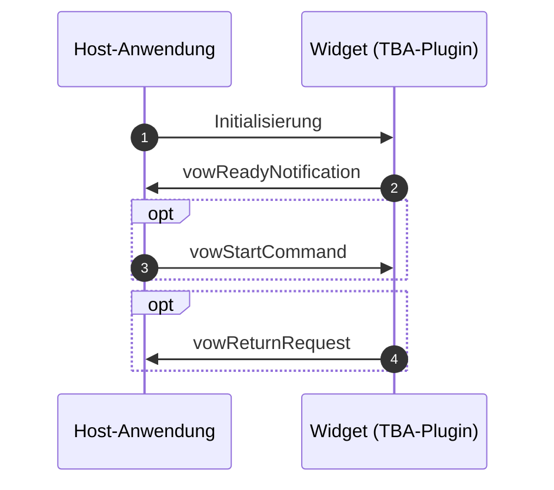

This repo is part of the tba specifications and focuses on the specification of widget plugin.

[Docs](https://iqb-specifications.github.io/concepts/plug-ins) (German only)

## release notes

Please see the [release section](https://github.com/iqb-specifications/plugin-widget/releases) of this repository to learn about changes.

## For Contributors

This api is written as [async api](https://www.asyncapi.com/de) yaml file. After committing to main branch, a GitHub action is triggered to build the html page. Create an release with release notes.

For a human readable version of the spec [see here](https://iqb-specifications.github.io/plugin-widget).

# Kommunikation

::: {#spec}

## 1 Initialisierung

Der Host richtet ein `<iframe>`-Element ein und setzt für das `srcdoc`-Attribut den kompletten Inhalt des Moduls. Das Modul ist technisch eine Html-Seite, d. h. es wird durch das Laden auch die Ausführung von JavaScript-Code angestoßen, der auf oberster Ebene vorgesehen ist.

## 2 Ready Notification

Dieser Code sendet als letzten Schritt der eigenen Initialisierung eine Nachricht an den Host, dass das Modul bereit sei für das Start-Kommando. Als Payload wird das [Metadaten-Objekt](https://iqb-specifications.github.io/concepts/plugins/metadata.html) mitgeschickt -- hier allerdings als String serialisiert, um nicht bei jeder Änderung der Metadaten-Spezifikation alle Modul-API ändern zu müssen.

## 3 Start Command

Das Startkommando ist nicht für alle Widgets zwingend erforderlich. Es könnte sich z. B. um eine statische Anzeige handeln, die keine weiteren Daten benötigt (z. B. interaktive Weltkarte).

Der Host kann jedoch über das Startkommando Daten schicken:

* `widgetConfig`: Einfache Liste von `key`/`value`-Paaren, die Varianten des Widgets steuern. Es könnte darüber beispielsweise ein bestimmter Funktionsumfang des Taschenrechners angefordert werden.
* `sharedParameters`: Einfache Liste von `key`/`value`-Paaren. Bedeutung siehe [hier](https://iqb-specifications.github.io/concepts/plugins/communication.html#gemeinsame-parameter-sharedparameters).
* `state`: Ein Zustand aus einem vorherige Aufruf des Widgets kann die UX verbessern.

## 4 State Changed Notification

Sobald eine Interaktion stattgefunden hat, kann das Widget diese Änderung melden. Parameter:

* `sessionId`: Die Kennung aus dem Start-Kommando, um die korrekte Zuordnung der Nachricht bzw. der darin enthaltenen Daten zur Unit zu unterstützen.
* `timeStamp`: Ein String im Standard-Format [date-time](https://tc39.es/ecma262/multipage/numbers-and-dates.html#sec-date-time-string-format). Die Nutzung dieser Information ist dem Host überlassen, soll aber vor allem die korrekte Reihenfolge vieler asynchron eintreffender Nachrichten sicherstellen.
* `sharedParameters`: Einfache Liste von `key`/`value`-Paaren. Bedeutung siehe [hier](https://iqb-specifications.github.io/concepts/plugins/communication.html#gemeinsame-parameter-sharedparameters).
* `state`: Der neue Bearbeitungsstatus als serialisiertes Datenobjekt (string).

Dass das Widget zwischenzeitlich einen neuen Status schickt, ist nicht erforderlich. Es könnte interessant sein, wenn man Bearbeitungsstände speichern möchte (Log).

## 5 Return Request

Diese Meldung wird an den Host geschickt, wenn die Testperson die Arbeit mit dem Widget beenden möchte. Über den Parameter `saveState` teilt das Widget mit, ob die Änderungen am Zustand/State wirksam (also an den Player geschickt) werden sollen, oder ob das Schließen ohne Speichern erfolgen soll (entspricht "Abbruch"). `state` und `sharedParameters` können mitgeschickt werden.

# Widget-Typen und ihre Parameter

## Molekül-Editor

**`MOLECULE_EDITOR` Version 0.1**

### Aufrufparameter

| Key    | Value | Erläuterung | Standardwert |
| --- | --- | ------- | --- |
| `BONDING_TYPE` | "VALENCE" für Valenzstrichformel, "ELECTRONS" für Elektronenformel | Der Aufrufer legt die Darstellungsform von Bindungen fest. | "ELECTRONS" |

### State

Als Status wird ein **JSON-Objekt** übergeben (als String). Zum gegenwärtigen Arbeitsstand ist nur der erste Parameter festgelegt:

* `asImage`: Hierbei handelt es sich um ein Bild, das den letzten Bearbeitungsstand darstellt. Als Format wird jpg oder png erwartet, serialisiert in Form von base64. Dieses Bild kann der aufrufende Player anzeigen und es wird für die manuelle Kodierung genutzt. Die Molekül-Darstellung sollte beschnitten sein, um Platz zu sparen.

Alle anderen Parameter sind geeignet, den Bearbeitungsstand ggf. wiederherzustellen.

### Shared Parameters

Keine.

## Periodensystem der Elemente

**`PSE` Version 1.0**

### Aufrufparameter

| Key    | Value | Erläuterung | Standardwert |
| --- | --- | ------- | --- |
| `SHOW_INFO_ORDER` | "0" steht für Nein, "1" steht für Ja  | legt fest, ob im Periodensystem die Ordnungszahl angezeigt wird | "1" |
| `SHOW_INFO_A_MASS` | "0" steht für Nein, "1" steht für Ja  | legt fest, ob im Periodensystem die mittlere relative Atommasse in u angezeigt wird | "1" |
| `SHOW_INFO_E_NEG` | "0" steht für Nein, "1" steht für Ja  | legt fest, ob im Periodensystem die Elektronegativität (nach Pauling) angezeigt wird; Achtung: Wird dann nur bei Hover/Auswahl angezeigt, nicht für alle Elemente | "0" |
| `MAX_NUMBER_OF_SELECTIONS` | Zahl als String  | "0" steht für unbegrenzte Anzahl, "1" steht für nur eine Selektion (das Selektieren eines weiteren Elements ersetzt die vorherige Selection), Wert > 1 führt bei Erreichen der Zahl zu einer Meldung| "1" |
| `CLOSE_ON_SELECTION` | "0" steht für Nein, "1" steht für Ja | legt fest, ob nach Auswahl eines Elementes das Widget sofort geschlossen werden soll (`vowReturnRequest`) | "0" |

### State

Als Status wird ein **String** übergeben, der mit **Leerzeichen getrennt** die Kürzel der gewählten Elemente enthält.

### Shared Parameters

Keine.

## Taschenrechner

**`CALC` Version 1.1**

### Aufrufparameter

| Key    | Value | Erläuterung | Standardwert |
| --- | --- | ------- | --- |
| `MODE` | "SIMPLE", "SCIENTIFIC" | legt das Spektrum der verfügbaren Funktionen fest | "SIMPLE" |
| `JOURNAL_LINES` | "0" steht für keine, > "0" steht für die Anzahl der Zeilen  | legt fest, ob bzw. mit wievielen Zeilen vorherige Rechenoperationen und Eingaben angezeigt werden | "0" |
| `MAX_IMAGE_WIDTH_PX` | numerisch positiv ganzzahlig  | legt die maximale Breite des Ergebnisbildes fest; längere Ausdrücke müssen umgebrochen werden | "200" |
| `JOURNAL` | `[{"asLatex": string; "asImage": string}]`  | stringified JSON-Objekt mit vorherigen Rechnungen, identisch mit dem State; der letzte Eintrag ist der aktuellste | `[]` |

### State

Als Status wird ein (stringified) **JSON-Objekt** übergeben. Es handelt sich um das Journal, also die letzten Rechnungen. Der Datentyp ist ein Array von Objekten mit folgenden Eigenschaften:

* `asLatex`: string; Ergebnis/Rechnung als Latex-Ausdruck. Beispiel: `\frac{1}{3}`
* `asImage`: string; Ergebnis/Rechnung als Bild. Als Format wird jpg oder png erwartet, serialisiert in Form von base64. Dieses Bild kann der aufrufende Player bzw. Host anzeigen.

Der letzte Eintrag des Arrays ist der jüngste.

### Shared Parameters

Keine.

:::